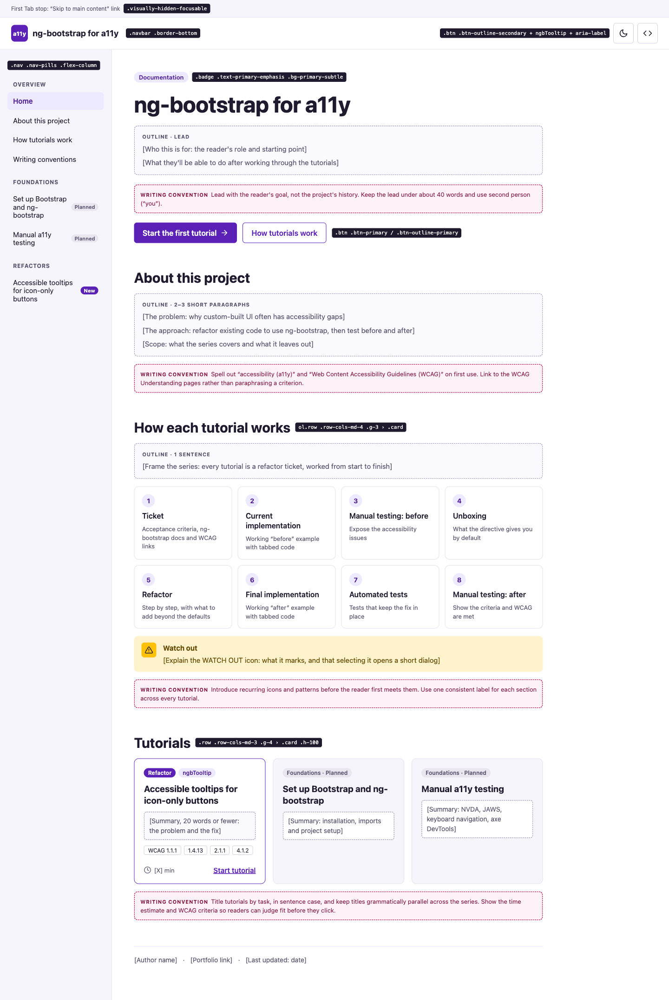
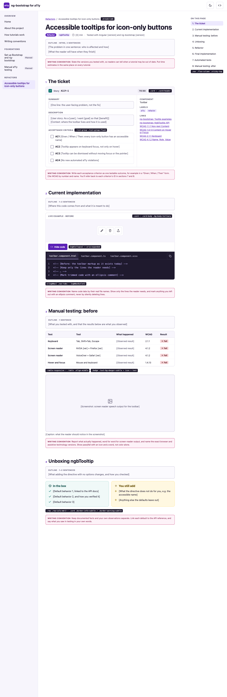
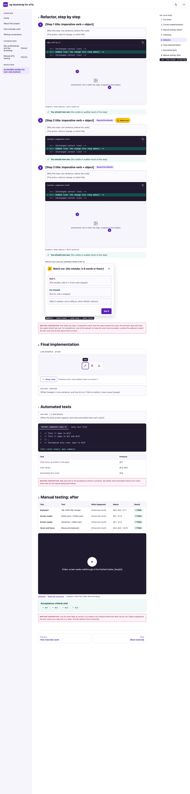
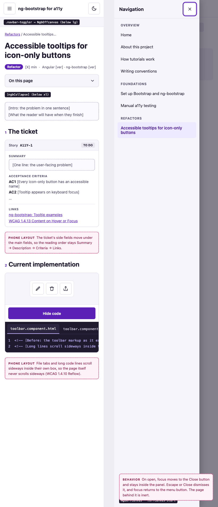

# Design

High-fidelity mockups for **ng-bootstrap for a11y**, a documentation site that shows how to use ng-bootstrap to improve accessibility in Angular apps.

**[View the mockups on the design canvas →](https://claude.ai/artifact/YNo5DKTvmajhYrEStYKJgC)**

The designs cover site structure, visual style, and the template every tutorial follows. Text areas hold outlines and writing-convention notes, not final copy.

## Contents

- [Screens](#screens)
- [Tutorial template](#tutorial-template)
- [Visual style](#visual-style)
- [Components](#components)
- [Accessibility decisions](#accessibility-decisions)
- [Small screens](#small-screens)
- [How to read the mockups](#how-to-read-the-mockups)

## Screens

| Screen | Purpose |
|--------|---------|
| [Home](https://claude.ai/artifact/YNo5DKTvmajhYrEStYKJgC#artboard-Home) | Introduces the project, explains how each tutorial is structured, and lists the tutorials. |
| [Tutorial (top)](https://claude.ai/artifact/YNo5DKTvmajhYrEStYKJgC#artboard-Tutorial) | The tutorial template, using *Accessible tooltips for icon-only buttons*: intro through section 4. |
| [Tutorial (continued)](https://claude.ai/artifact/YNo5DKTvmajhYrEStYKJgC#artboard-TutorialContinued) | The same page, sections 5–8 and the previous/next links. |
| [Phone width](https://claude.ai/artifact/YNo5DKTvmajhYrEStYKJgC#artboard-Mobile) | The tutorial on a phone, with the navigation panel closed and open. |
| [Style and writing conventions](https://claude.ai/artifact/YNo5DKTvmajhYrEStYKJgC#artboard-StyleGuide) | Color tokens, type scale, reusable components and writing rules. |

The tutorial page is split across two frames because the canvas limits a frame's height. On the site it is one page.

### Home

### Tutorial template

### Phone width

### Style and writing conventions

### Layout

Every page has a header, a left side nav and a main content area. Tutorial pages add an **On this page** list on the right.

The side nav groups pages into three sections:

- **Overview:** Home, About this project, How tutorials work, Writing conventions
- **Foundations:** guides the refactor tutorials build on, such as setup and manual testing
- **Refactors:** ticket-based tutorials, such as accessible tooltips

## Tutorial template

Each tutorial is written as a refactor ticket worked from start to finish.

| # | Section | What it shows |
|---|---------|---------------|
| 1 | The ticket | Summary, user story, acceptance criteria, and links to the ng-bootstrap docs and WCAG success criteria |
| 2 | Current implementation | A working "before" example with a **Show code** button that opens tabbed source files |
| 3 | Manual testing: before | Keyboard and screen-reader results that expose the issues |
| 4 | Unboxing | What the ng-bootstrap directive provides by default, compared with what you still need to add |
| 5 | Refactor, step by step | Numbered steps with code changes, screenshots, and **Watch out** notes about common mistakes |
| 6 | Final implementation | A working "after" example with the same code viewer |
| 7 | Automated tests | Test code, each test mapped to the acceptance criterion it protects |
| 8 | Manual testing: after | The same tests as section 3, now passing, plus a video walkthrough with captions and a transcript |

Sections 3 and 8 use the same table so readers can compare results row by row.

## Visual style

The site is styled with Bootstrap utility classes wherever possible and themed through Bootstrap's Sass variables rather than custom CSS.

### Color: deep violet

| Token | Hex | Use | Contrast |
|-------|-----|-----|----------|
| `$primary` | `#5B21B6` | Buttons, links, focus ring | 9.0:1 on white |
| `$primary-text-emphasis` | `#4C1D95` | Hover states, active nav text | 11.0:1 on white |
| `$primary-bg-subtle` | `#EDE9FE` | Active nav item, Note callouts | `$primary` on it: 7.6:1 |
| `$body-color` | `#1F1A2E` | Body text | 16.9:1 on white |
| `$secondary-color` | `#5B5670` | Secondary text | 7.0:1 on white |
| `$info` | `#0F766E` | Tip callouts, "In the box" | 5.5:1 on white |
| `$warning` | `#FFC107` | Watch out buttons (with dark text) | Text on it: 10.3:1 |
| `$body-tertiary-bg` | `#F7F5FC` | Side nav, example areas | Background surface |

Every text color meets WCAG AA (4.5:1) with room to spare.

### Type

Bootstrap's default system font stack, with no web fonts to download.

| Role | Size and weight |
|------|-----------------|
| Page title | 44px, bold |
| Section heading | 30px, bold |
| Step title | 21px, bold |
| Body | 16px, line height 1.5 |
| Captions, metadata | 14px |
| Code | 14px monospace |

## Components

| Component | Built with |
|-----------|-----------|
| Side nav | `.nav .nav-pills .flex-column` |
| Tabbed code viewer | `ngbNav` with `.nav-tabs`, shown and hidden with `ngbCollapse` |
| Watch out button and dialog | `.btn .btn-warning .rounded-pill`, opening `NgbModal` |
| Callouts (Note, Tip, result) | `.alert-primary`, `.alert-info`, `.alert-success` |
| Pass and fail labels | `.badge` with an icon and a word |
| Test results | `.table` inside `.table-responsive` |
| Screenshots | `figure.figure` with numbered callouts and a caption |
| Header icon buttons | `.btn` with `aria-label` and `ngbTooltip` |
| Phone navigation | `NgbOffcanvas` |

Wherever the site needs a component, it uses the ng-bootstrap one, so the site demonstrates the patterns its tutorials teach.

## Accessibility decisions

- **Visible focus.** Bootstrap's default focus ring is 25% opacity, about 1.5:1 against white, which fails [WCAG 1.4.11 Non-text Contrast](https://www.w3.org/WAI/WCAG22/Understanding/non-text-contrast.html). The designs use a solid 3px ring with a 2px offset (9.0:1).
- **Color is never the only signal.** Pass and fail labels pair an icon with a word. Added code lines show a `+` as well as a tint.
- **Every icon-only button has an accessible name.** This includes the site's own header buttons and copy-code buttons.
- **Watch out buttons have a text label.** Their accessible names include the mistake, so a list of a page's buttons stays meaningful.
- **Touch targets are at least 44 × 44px.**
- **Skip link.** "Skip to main content" is the first Tab stop, using `.visually-hidden-focusable`.
- **Video supports the text, never replaces it.** Every video has captions and a transcript, and no step appears only in a video.

## Small screens

| Breakpoint | Behavior |
|------------|----------|
| Below `lg` | The side nav moves into an `NgbOffcanvas` panel opened from a menu button. Focus moves into the panel, Escape closes it, and focus returns to the menu button. |
| Below `xl` | **On this page** becomes a collapsed toggle at the top of the content (`ngbCollapse`). |
| Phone | The ticket's fields stack into one column. Code tabs, long code lines and tables scroll sideways inside their own boxes, so the page never scrolls sideways ([WCAG 1.4.10 Reflow](https://www.w3.org/WAI/WCAG22/Understanding/reflow.html)). |

## How to read the mockups

The mockups use three kinds of annotation. None of them appear on the real site.

| Annotation | Looks like | Meaning |
|------------|-----------|---------|
| Outline | Gray dashed box with `[bracketed prompts]` | What content goes here |
| Writing convention | Pink dashed box | A suggested writing rule for that section |
| Class label | Small dark tag in monospace | The Bootstrap or ng-bootstrap classes to build it with |

To show or hide writing conventions and class labels, open a screen's **Tweaks** panel on the canvas.

## Related

- [BUILD_PLAN.md](BUILD_PLAN.md): decisions, planned tutorials and open questions
