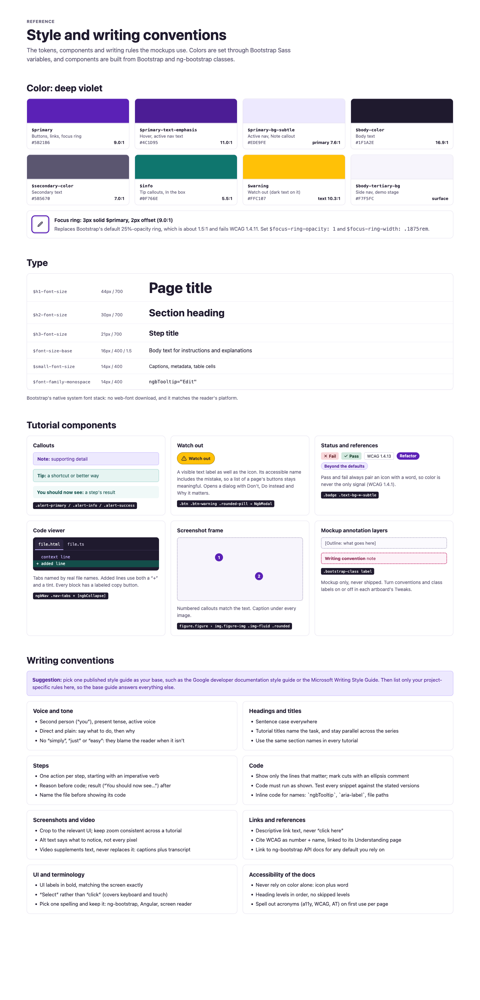

# Design

[Intro: what this file covers and who it's for]

**[View the mockups on the design canvas →](https://claude.ai/artifact/YNo5DKTvmajhYrEStYKJgC)**

[Note on the mockups: text areas hold outlines and writing-convention notes, not final copy]

## Contents

- [Screens](#screens)
- [Tutorial template](#tutorial-template)
- [Visual style](#visual-style)
- [Components](#components)
- [Accessibility decisions](#accessibility-decisions)
- [Small screens](#small-screens)
- [How to read the mockups](#how-to-read-the-mockups)

## Screens

| Screen | Purpose |
|--------|---------|
| [Home](https://claude.ai/artifact/YNo5DKTvmajhYrEStYKJgC#artboard-Home) | [Purpose of the Home page] |
| [Tutorial (top)](https://claude.ai/artifact/YNo5DKTvmajhYrEStYKJgC#artboard-Tutorial) | [What this frame shows: intro through section 4] |
| [Tutorial (continued)](https://claude.ai/artifact/YNo5DKTvmajhYrEStYKJgC#artboard-TutorialContinued) | [What this frame shows: sections 5–8 and previous/next links] |
| [Phone width](https://claude.ai/artifact/YNo5DKTvmajhYrEStYKJgC#artboard-Mobile) | [What this frame shows: nav closed and open] |
| [Style and writing conventions](https://claude.ai/artifact/YNo5DKTvmajhYrEStYKJgC#artboard-StyleGuide) | [What this frame shows] |

[Note: why the tutorial is split across two frames (the canvas caps a frame at 8,000px)]

### Home

### Tutorial template

### Phone width

### Style and writing conventions

### Layout

[Describe the shared layout: header, left side nav, main content, and the "On this page" list on tutorial pages]

[Describe the side nav groups and what belongs in each]

- **Overview:** Home, About this project, How tutorials work, Writing conventions
- **Foundations:** [what this group holds]
- **Refactors:** [what this group holds]

## Tutorial template

[One sentence: the ticket-based refactor framing]

| # | Section | What it shows |
|---|---------|---------------|
| 1 | The ticket | [What it shows] |
| 2 | Current implementation | [What it shows] |
| 3 | Manual testing: before | [What it shows] |
| 4 | Unboxing | [What it shows] |
| 5 | Refactor, step by step | [What it shows] |
| 6 | Final implementation | [What it shows] |
| 7 | Automated tests | [What it shows] |
| 8 | Manual testing: after | [What it shows] |

[Note: sections 3 and 8 share one table layout, and why]

## Visual style

[How the site is styled: Bootstrap utility classes, themed through Sass variables]

### Color: deep violet

| Token | Hex | Use | Contrast |
|-------|-----|-----|----------|
| `$primary` | `#5B21B6` | Buttons, links, focus ring | 9.0:1 on white |
| `$primary-text-emphasis` | `#4C1D95` | Hover states, active nav text | 11.0:1 on white |
| `$primary-bg-subtle` | `#EDE9FE` | Active nav item, Note callouts | `$primary` on it: 7.6:1 |
| `$body-color` | `#1F1A2E` | Body text | 16.9:1 on white |
| `$body-secondary-color` | `#5B5670` | Secondary text | 7.0:1 on white |
| `$info` | `#0F766E` | Tip callouts, "In the box" | 5.5:1 on white |
| `$warning` | `#FFC107` | Watch out buttons (with dark text) | Text on it: 10.3:1 |
| `$body-tertiary-bg` | `#F7F5FC` | Side nav, example areas | Background surface |

[Summary of how the palette meets WCAG AA]

### Type

[Font choice and why]

| Role | Size and weight |
|------|-----------------|
| Page title | 44px, bold |
| Section heading | 30px, bold |
| Step title | 21px, bold |
| Body | 16px, line height 1.5 |
| Captions, metadata | 14px |
| Code | 14px monospace |

## Components

| Component | Built with |
|-----------|-----------|
| Side nav | `.nav .nav-pills .flex-column` |
| Tabbed code viewer | `ngbNav` with `.nav-tabs`, shown and hidden with `ngbCollapse` |
| Watch out button and dialog | `.btn .btn-warning .rounded-pill`, opening `NgbModal` |
| Callouts (Note, Tip, result) | `.alert-primary`, `.alert-info`, `.alert-success` |
| Pass and fail labels | `.badge` with an icon and a word |
| Test results | `.table` inside `.table-responsive` |
| Screenshots | `figure.figure` with numbered callouts and a caption |
| Header icon buttons | `.btn` with `aria-label` and `ngbTooltip` |
| Phone navigation | `NgbOffcanvas` |

[Why the site uses ng-bootstrap components itself]

## Accessibility decisions

- **Visible focus.** [Bootstrap's default ring and why it fails WCAG 1.4.11; the replacement: 3px `$primary` outline with a 2px white gap]
- **Color is never the only signal.** [Examples: pass/fail labels, added code lines]
- **Every icon-only button has an accessible name.** [Where this applies]
- **Watch out buttons have a text label.** [Why]
- **Touch targets are at least 44 × 44px.**
- **Skip link.** [What it is and where it sits in the Tab order]
- **Video supports the text, never replaces it.** [Captions and transcripts]

## Small screens

| Breakpoint | Behavior |
|------------|----------|
| Below `lg` | [Side nav in `NgbOffcanvas`: how it opens, where focus goes, how it closes] |
| Below `xl` | [The "On this page" list as an `ngbCollapse` toggle] |
| Phone | [Ticket stacking; sideways scrolling inside code and tables; WCAG 1.4.10 Reflow] |

## How to read the mockups

[One sentence: the annotations are mockup-only]

| Annotation | Looks like | Meaning |
|------------|-----------|---------|
| Outline | Gray dashed box with `[bracketed prompts]` | [Meaning] |
| Writing convention | Pink dashed box | [Meaning] |
| Class label | Small dark tag in monospace | [Meaning] |

[How to show or hide the annotation layers in the canvas's Tweaks panel]

## Related

- [BUILD_PLAN.md](BUILD_PLAN.md): [what it contains]
